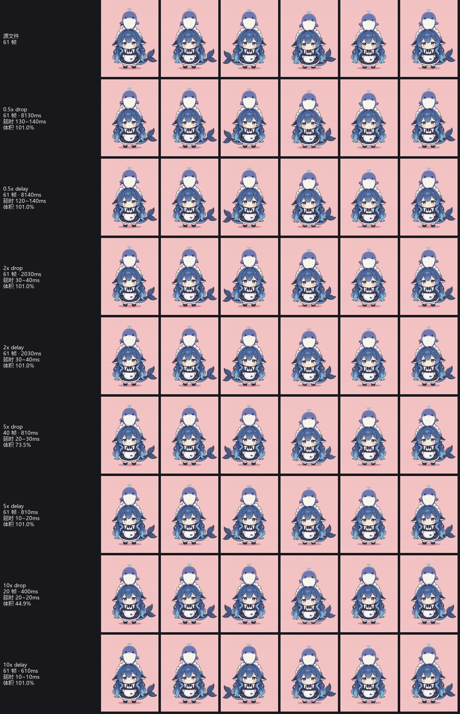

# gifspeed —— GIF 变速工具

把 GIF 加速或减速后保存。命令行 + tkinter 图形界面，纯 Python（Pillow），零外部依赖。

> 市面上大多数工具只是把每帧的延时字段改小，而 GIF 的延时单位是
> **1/100 秒**，浏览器又规定**小于等于 10ms 的延时会按 100ms 播**。所以一个 10fps 的 GIF
> 用普通工具调到 10 倍速，帧延时从 10cs 变成 1cs，浏览器一看「≤10ms」，直接按 100ms 播
> ——结果**还是原来的速度**，白调。
> gifspeed 会在缩延时撞到这个下限时**自动改成丢帧**，保证你得到的倍速和你要的一致。

---

## 快速开始

```bat
:: 信息模式：先看看这个 GIF 到底长什么样
python -m gifspeed demo.gif --info

:: 一次出齐四个倍速（0.5x 慢放、2x、5x、10x 快放）
python -m gifspeed demo.gif --speeds 0.5,2,5,10 -o out

:: 整目录批量 + JSON 报告
python -m gifspeed .\gifs -r -o .\out --speeds 0.5,2,5,10 --json report.json

:: 顺带裁剪 + 缩小 + 减色
python -m gifspeed demo.gif -s 2 --crop 0,0,300,300 --scale 0.5 --colors 128

:: 打开图形界面
python -m gifspeed --gui
```

Windows 上如果 `python` 不是装了 Pillow 的那个解释器，用自带的启动器最省事——它会自己找一个装了 Pillow
的解释器（依次试 `python`、`py`、以及 `%LOCALAPPDATA%\Programs\Python\Python3xx\python.exe`）：

```bat
gifspeed.cmd demo.gif -s 2
gifspeed.cmd --speeds 0.5,2,5,10 -o out
gifspeed.cmd --gui
```

也可以自己指定解释器：

```bat
"%USERPROFILE%\.dsh\dsh-runtimes\dsh-primary-runtime\dependencies\python\python.exe" -m gifspeed demo.gif -s 2
```

### 报 `ModuleNotFoundError: No module named 'PIL'` 怎么办

说明你当前用的这个 Python 没装 Pillow。给它装上就行：

```bat
python -m pip install Pillow
```

不想装也没关系——gifspeed 检测到缺 Pillow 时会直接给出上面这条命令和当前解释器的完整路径，
而不是甩一个 traceback 出来。实测可用组合：Python 3.12 与 3.14.5 + Pillow 12.3.0。

---

## 两种变速模式

| 模式 | 做什么 | 帧数 | 何时用 |
|---|---|---|---|
| `--mode drop`（**默认**） | 只改延时；当延时要低于下限时**丢帧**，把省下的时间分给留下的帧 | 变少 | 想要**真的变快**。这是唯一能突破浏览器下限的做法 |
| `--mode delay` | 保留**全部**帧，只改延时 | 不变 | 想要**最平滑**，且倍速不激进（或做慢放）。超过约 5x 后会失效，工具会明确告警 |

`drop` 模式的最小延时默认 20ms，正好是浏览器下限。用 `--min-delay` 可以调，
但调到 20 以下就可能被浏览器抬到 100ms——工具会在结果里标出来。

**加速上限**：一个 GIF 用 `drop` 模式最多能快 `源最小延时 ÷ 20ms` 倍（再快就只能留 1 帧，变成静图）。
慢放没有上限（GIF 延时字段最大 65535cs ≈ 10.9 分钟/帧）。

---

## 命令行参数

```
位置参数
  inputs                  GIF 文件或目录（目录会用 --pattern 扫描）

倍速
  -s, --speed FLOAT       单个倍速，例如 2 或 0.5（默认 2）
      --speeds LIST       多个倍速，逗号分隔，例如 0.5,2,5,10（每个倍速一个文件）
      --mode {drop,delay} 变速模式，默认 drop
      --min-delay MS      drop 模式的最小帧延时，默认 20

输出
  -o, --outdir DIR        输出目录（默认与源文件同目录）
      --name-template TPL 文件名模板，可用 {stem} {speed} {ext}，默认 {stem}_{speed}x.gif
      --overwrite         覆盖已有输出（默认）
      --no-overwrite      已存在则跳过
      --json PATH         把自检结果写成 JSON

画面变换
      --reverse           反向播放
      --colors N          减色到 N 色（有损）
      --scale FLOAT       缩放比例，例如 0.5
      --width N           目标宽度（高按比例）
      --height N          目标高度（宽按比例）
      --crop x,y,w,h      裁剪区域（宽高，不是右下角坐标）
      --start SEC         只处理该秒之后的部分
      --end SEC           只处理该秒之前的部分

编码
      --loop N            循环次数，0=无限（默认沿用源文件）
      --no-loop           不循环，只播一次
      --disposal {0,1,2,3} 强制 disposal 方式（默认 1，体积最小）
      --no-optimize       关闭调色板优化（体积通常更大）
      --no-verify         跳过写回后的逐像素自检（更快）

批量与诊断
  -r, --recursive         递归扫描子目录
      --pattern GLOB      目录扫描通配符，默认 *.gif
      --info              只打印源文件信息，不转换
  -v, --verbose           打印字节级细节
      --quiet             只输出结果路径
      --dry-run           只显示将要做什么，不写文件
      --gui               打开图形界面
      --version           版本号
```

---

## 图形界面

`python -m gifspeed --gui` 打开一个 tkinter 窗口：选文件 / 选输出目录 / 勾选倍速 /
选模式 / 可选裁剪缩放减色 / 实时日志。功能与命令行一一对应，底层调用同一个 `convert_many`。

---

## Python API

```python
from gifspeed import convert, convert_many, load_gif, plan_speed

# 先看源文件
info = load_gif("demo.gif")
print(info.summary())        # demo.gif: 462x459, 78 帧, 总时长 7800ms, 延时 100~100ms, 循环=无限, 全帧, 透明=无, 8361KB

# 算一下计划（不写文件）
plan = plan_speed(info.delays, 10.0, mode="drop", min_delay_ms=20)
print(plan.out_frames, plan.dropped, plan.total_ms, plan.achieved_speed)

# 转换（verify=True 会在写回后逐像素自检）
result = convert("demo.gif", "out/demo_10x.gif", 10.0, mode="drop", verify=True)
print(result.ok, result.out_size, result.speed_error_ms, result.lossless)

# 批量
results = convert_many(
    ["a.gif", "b.gif"], [0.5, 2, 5, 10],
    outdir="out", mode="drop", verify=True,
)
```

主要导出：`load_gif`、`plan_speed`、`convert`、`convert_many`、`save_gif`、`pixel_diff`、
`Transform`、`EncodeOptions`、`SpeedPlan`、`GifInfo`、`ConversionResult`、
`read_gif_raw`、`format_result`、`format_summary`、`results_to_json`。

---

## 核心算法

### 1. drop 模式：时间轴重采样 + 误差扩散

```
目标总时长 T = 源总时长 / 倍速
输出帧数   n = clamp(floor(T / min_delay), 1, 源帧数)
每帧间隔   step = T / n
第 j 帧取自源时间轴上的中点 t_j = (j + 0.5) * step
```

- 取**中点**而不是起点，避免丢帧时系统性地偏向每一段的开头，运动更居中。
- 每个 `t_j` 映射到源帧索引，得到 `src_indices`（**严格递增、不重复**）。
- 延时按 10ms（1cs）量化，量化余数**累加到下一帧**（误差扩散），所以总时长不会随帧数累积漂移。

实测（本文档末尾的验证章节）：78 帧 7800ms 的 GIF 调到 10x → 20 帧 400ms，偏差 0ms。

### 2. delay 模式：只缩延时

每帧延时 = `round(源延时 / 倍速)`，下限 `ABSOLUTE_MIN_MS = 10ms`，同样做误差扩散。
之所以下限是 10ms 而不是 0：延时 0 在 GIF 里语义含糊，多数浏览器也会当成 100ms，
写 10ms 反而更可预期。

### 3. 帧归一化（这是保证无损的关键）

GIF 普遍是「优化过的」：第 2 帧起只存变化区域（差异帧）+ 透明色索引。
要在这种文件上丢帧，必须先合成出完整帧，否则丢帧后会看到残缺画面。
`load_gif` 通过 Pillow 的 seek 自动完成合成，但 Pillow 有两个坑必须绕开：

1. **加载策略**。Pillow 的 `GifImagePlugin.LOADING_STRATEGY` 默认是 `RGB_AFTER_FIRST`，
   于是第 1 帧是 P 模式（带调色板），**第 2 帧起变成 RGBA 且没有调色板**。
   把这种混合列表交给编码器，非 P 帧会被重新量化（实测 254 色塌成 55 色），
   而且 Pillow 的差异帧压缩是按**调色板下标**比较的，两张不同色表的「下标相等」
   根本不代表颜色相等 → 画面直接写坏。
   gifspeed 在读写两侧都用 `RGB_AFTER_DIFFERENT_PALETTE_ONLY` 策略包住，保证所有帧都是 P 模式。
2. **透明索引**。Pillow 报的 `transparency` 经常与实际不符，而且源文件里那个索引
   可能压根没被用到。`load_gif` 会把 `transparency` 元数据一律剥掉，
   只在索引**确实被像素用到**时才用背景色填实。这样编码器看到的是「全不透明完整帧」，
   可以放心做帧间差异压缩。

因为帧已经归一化成完整帧，`disposal` 用 1（不还原上一帧）永远正确，
而且只有它能启用差异压缩——实测同内容 `disposal=2` 的体积是它的 2.15 倍。

### 4. 写回自检

`convert(..., verify=True)`（默认开）会用 Pillow 把刚写的文件读回来，
逐像素和内存里的期望帧比对（`pixel_diff`）。任何不一致都会写进结果的 `lossless` 和
`max_pixel_diff`，并在汇总里高亮。

---

## 验证

### 方法

`gifspeed` 自己用 Pillow 读写——如果编码器和解码器犯了同一个错，自检会一起骗过。
所以仓库里带了一个**独立**验证脚本 `verify_gifspeed.py`，它用 **ffmpeg 当第二个解码器**：
把源文件和每个输出文件都解成 PNG 序列，再逐帧、逐像素比对，同时解析输出的字节级延时结构。

```bat
python verify_gifspeed.py
python verify_gifspeed.py --quick      :: 每 4 帧只比 1 帧，跑得快
```

产物：`.verify/verify.json`（全部数据）、`.verify/compare_*.png`（对比图）、
`.verify/results/`（16 个输出 GIF）。

### 界面自检

`SpeedApp` 的做法是「一个方法配一个同名属性」，很容易出现实例属性把方法覆盖掉的情况，
症状是**按钮点下去毫无反应**（异常只往 stderr 里写）。`test_gui.py` 专门盯这个：

```bat
python test_gui.py
```

它会检查 ① 没有实例属性覆盖 `SpeedApp` 的方法、② 关键方法仍可调用、
③ 每个按钮的 `command` 都指向真正的可调用对象。无图形环境时自动跳过。

### 测试素材

| 文件 | 尺寸 | 帧数 | 延时 | 总时长 | 体积 | 特点 |
|---|---|---|---|---|---|---|
| `66C1EC40389049F55EE62882A7825F54.gif` | 462×459 | 78 | 恒定 100ms | 7800ms | 8361KB | GIF87a，全帧无差异，251 色 |
| `4D4E5531856363FC1FDFD085306F80A5.gif` | 360×480 | 61 | 70ms×41 + 60ms×20 | 4070ms | 1678KB | GIF89a，**58/61 是差异帧**，变延时，92~99 色 |

第二个文件是关键素材：它既用了差异帧，延时又不均匀，正好覆盖最容易出错的情况。

### 结果

用工作区的两个 GIF × 4 个倍速（0.5 / 2 / 5 / 10）× 2 种模式，共 **16 个用例**：

| | |
|---|---|
| 转换成功 | **16 / 16** |
| **ffmpeg 独立解码后逐像素无损** | **16 / 16**（最大通道差 0） |
| Pillow 写回自检无损 | 16 / 16 |
| 产生 0cs 延时的输出 | **0 个** |
| 总耗时 | 34.6 秒 |

`66C1EC40389049F55EE62882A7825F54.gif`（78 帧 / 7800ms / 恒定 100ms）：

| 倍速 | 模式 | 帧数 | 输出时长 | 偏差 | 体积 | 浏览器实际 |
|---|---|---|---|---|---|---|
| 0.5x | drop / delay | 78 | 15600ms | +0ms | 100.7% | 0.50x |
| 2x | drop / delay | 78 | 3900ms | +0ms | 100.7% | 2.00x |
| 5x | drop / delay | 78 | 1560ms | +0ms | 100.7% | 5.00x |
| **10x** | **drop** | **39** | 780ms | +0ms | **49.9%** | **10.00x** |
| 10x | delay | 78 | 780ms | +0ms | 100.7% | ⚠️ **1.00x（失效）** |

`4D4E5531856363FC1FDFD085306F80A5.gif`（61 帧 / 4070ms / 60~70ms 变延时 / 58 个差异帧）：

| 倍速 | 模式 | 帧数 | 输出时长 | 偏差 | 体积 | 浏览器实际 |
|---|---|---|---|---|---|---|
| 0.5x | drop / delay | 61 | 8130 / 8140ms | −10 / +0ms | 101.0% | 0.50x |
| 2x | drop / delay | 61 | 2030ms | −5ms | 101.0% | 2.00x |
| **5x** | **drop** | **40** | 810ms | −4ms | **73.5%** | **5.02x** |
| 5x | delay | 61 | 810ms | −4ms | 101.0% | ⚠️ **0.90x（失效）** |
| **10x** | **drop** | **20** | 400ms | −7ms | **44.9%** | **10.18x** |
| 10x | delay | 61 | 610ms | **+203ms** | 101.0% | ⚠️ **0.67x（比原图还慢）** |

几个值得注意的点：

- 在 20ms 下限**之上**（GIF1 的 0.5/2/5x），`drop` 和 `delay` 结果完全一样，偏差都是 **0ms**。
- 一旦跌破下限（GIF1 10x、GIF2 5x/10x），`drop` 自动丢帧并**精确命中**请求倍速，
  `delay` 则被浏览器钳制、倍速失效甚至反向。
- **GIF2 的 10x `delay` 是最戏剧性的反例**：用户要 10 倍速，得到的是 **0.67x 慢放**。
  详见 [`验证报告.md`](验证报告.md)。



（上图为源文件与 0.5x / 2x / 5x / 10x × drop / delay 结果在整段动画上均匀采样的对比。
注意 5x / 10x 那几行：`drop` 抽掉的帧让姿态明显跳得更快，`delay` 帧数不变、只是每帧停留更短。）

---

## 已知限制

- **不能超过 50fps**。GIF 延时字段最小有意义的值是 2cs（20ms），浏览器也不显示更快的。
  真需要 60fps 请转 MP4/WebM——那已经不是 GIF 了。
- **`delay` 模式在高倍速下会失效**，这是浏览器的行为，不是 bug。工具会告警并给出实际倍速。
- **减色（`--colors`）是有损的**，默认不减色。
- **源文件如果含多张局部色表**，会被重新索引到第一张色表上，可能有细微色差（工具会打印提示）。
  这是为了让帧间差异压缩能工作而做的取舍。
- **体积**：GIF 的 LZW 编码器各家不同，gifspeed 的输出通常比原文件大 1% 左右
  （源文件往往是专用编码器压过的）。丢帧会按比例减小体积。
- 输出延时按 1cs（10ms）量化，所以倍速是近似的；工具会报告精确偏差。

---


## 文件结构

```
gifspeed/
  __init__.py     公开 API 与版本号（缺 Pillow 时给出中文安装指引）
  __main__.py     python -m gifspeed 入口
  core.py         解码 / 归一化 / 变速计划 / 变换 / 编码 / 自检
  report.py       手写 GIF 字节解析器（独立于 Pillow 的第二个真相来源）+ 报表格式化
  cli.py          命令行
  gui.py          tkinter 图形界面
gifspeed.cmd        Windows 启动器：自动挑一个装了 Pillow 的解释器
verify_gifspeed.py  ffmpeg 独立交叉验证脚本（16 个用例，逐像素比对）
test_gui.py         界面绑定自检（属性覆盖方法 / 按钮回调不可调用）
requirements.txt    pip 依赖清单
README.md           本文件
验证报告.md          完整验证数据与结论
LICENSE             MIT
docs/               README 用到的对比图
.gitattributes      行尾规则（`*.cmd` 强制 CRLF，cmd.exe 不接受裸 LF）
.gitignore          忽略验证产物、转换输出与测试素材
```

仓库里**没有**的东西（都在 `.gitignore` 里，需要时本地重新生成）：

```
.verify/            验证产物：verify.json、16 个输出 GIF、逐帧 PNG（约 280 MB）
out/                转换输出
*.gif               测试素材
```

跑一遍 `python verify_gifspeed.py` 就会重新生成 `.verify/`。

`report.py` 里的 `read_gif_raw` 是一个**不依赖 Pillow** 的 GIF 字节解析器：
它按 GIF89a 规范手工走块结构，读出每帧的 GCE 延时、disposal、透明标志、
图像描述符包围盒、NETSCAPE 循环次数。自检和报表都用它，
这样「Pillow 说的」和「文件里真正写的」是两条独立的证据链。

---

## 依赖

- Python 3.10+
- Pillow（唯一必需依赖，`pip install Pillow`）
- tkinter（只有 `--gui` 需要；Python 官方 Windows 安装包自带）
- ffmpeg（只有 `verify_gifspeed.py` 需要）

---

## 作者

| | |
|---|---|
| **[ruozao](https://github.com/ruozao)** | 需求、设计、验收与发布 |
| **DeepSeek AI 编程助手** | 代码实现、市面产品调研、独立交叉验证 |

这个项目的需求由 [ruozao](https://github.com/ruozao) 提出，实现全部由 **DeepSeek 的 AI 编程助手**
在对话中完成：核心变速算法、CLI 与 tkinter 界面、不依赖 Pillow 的 GIF 字节解析器、
以及那套「用 ffmpeg 当第二个解码器」的独立验证脚本。

顺带一提，开发过程里踩的两个坑也记在 [`验证报告.md`](验证报告.md) 里：
Pillow 默认加载策略把第 2 帧起读成 RGBA、导致自检假通过（见「二、验证方法」），
以及 GUI 里变量名覆盖方法名、导致「开始转换」静默失效（见 7.1 节）。

---

## 许可证

[MIT](LICENSE) © 2026 ruozao
